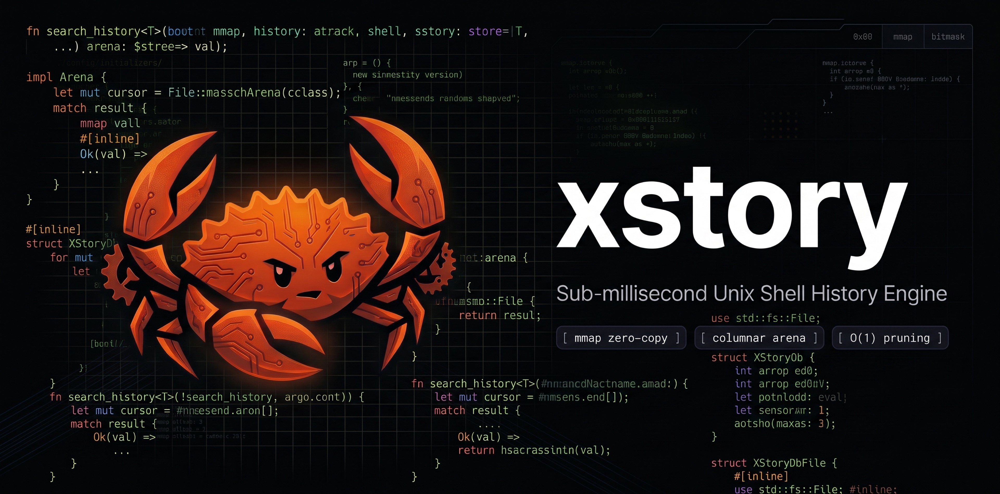
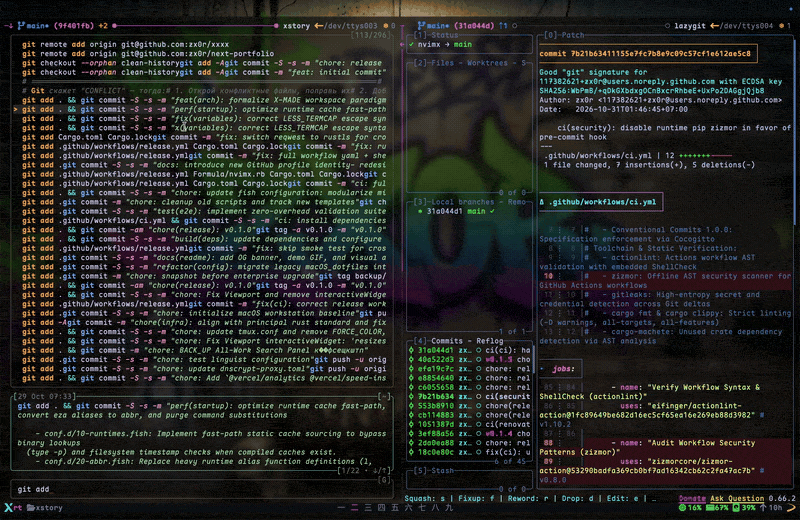

<p align="center">
  <a href="https://github.com/zx0r/xstory/releases">
    
  </a>
  <a href="LICENSE-MIT">
    
  </a>
  <a href="https://www.rust-lang.org/">
    
  </a>
  <a href="https://specifications.freedesktop.org/basedir-spec/basedir-spec-latest.html">
    
  </a>
</p>

<p align="center">
  
</p>

<p align="center">
  <a href="https://github.com/user-attachments/assets/808dbcbd-fad3-43f3-a6c9-788406c55331">
    
  </a>
</p>

---

### Installation

```bash
# Cargo (crates.io)
cargo install xstory

# Homebrew (macOS / Linux)
brew install zx0r/tap/xstory

# Build from source (LTO fat, stripped)
gh repo clone zx0r/xstory
cd xstory && just release
```

---

### Shell Integration

```bash
# Zsh (~/.zshrc)
eval "$(xstory init zsh)"

# Bash (~/.bashrc)
eval "$(xstory init bash)"

# Fish (~/.config/fish/config.fish)
xstory init fish | source
```
---

### Architecture

- **Memory-mapped history**: the file is mapped into memory directly; commands without escape sequences are read zero-copy.
- **Compact command storage**: short commands (≤ 12 bytes) live inline in a 16-byte descriptor; longer ones reference the mapped file.
- **Bitmask pre-filter**: each candidate is rejected in a single bitwise check before scoring runs.
- **Newest-wins dedup**: duplicate commands are collapsed on load; only the most recent invocation survives.
- **Built-in syntax highlighting**: tree-sitter Bash parser runs in-process with a slot cache; no external processes.

---

### Keybinding

Layout uses a 3-panel stacked hierarchy: `History` $\rightarrow$ `Preview` $\rightarrow$ `Query`.

| Key | Context | Action |
|---|---|---|
| `Enter` | Any | Accept command and execute immediately (exit code `0`) |
| `Tab` | Any | Insert command into shell buffer for editing without executing (exit code `2`) |
| `Ctrl+R` | Any | Toggle search scope: **`[G]`** (Global) $\leftrightarrow$ **`[L]`** (CWD only) |
| `Ctrl+T` | Any | Cycle syntax theme: `dark` → `light` → `catppuccin` → `tokyo-night` → `gruvbox` → `nord` → `cake` |
| `Shift+Up` | Any | Directional focus step upward (`Query` $\rightarrow$ `Preview` $\rightarrow$ `History`) |
| `Shift+Down` | Any | Directional focus step downward (`History` $\rightarrow$ `Preview` $\rightarrow$ `Query`) |
| `Up` / `Down` | `History` focused | Navigate selection (bottom-up reverse-chronological) |
| `Up` / `Down` | `Preview` focused | Scroll code lines inside the preview pane |
| `Left` / `Right` | Any | Move cursor in query line (switches focus to `Query`) |
| `Ctrl+U` | `Query` focused | Delete query to start of line |
| `Esc` / `Ctrl+C` | Any | Abort and return to shell prompt unchanged (exit code `130`) |

---

### Query

| Pattern | Mode | Semantics |
|---|---|---|
| `cargo test` | Fuzzy | Subsequence match with word-boundary weighting and reverse-chrono ordering |
| `'release` | Substring | Contiguous exact substring match |
| `^git` | Prefix | Matches commands starting with `git` |
| `main$` | Suffix | Matches commands ending with `main` |

---

### Configuration

```toml
# [OPTIONAL] Path: '~/.config/xstory/config'

history_path = "~/.local/share/xstory/history.tsv"
scroll_off = 4
preview_mode = "fixed" # OR "dynamic"
theme = "dark" # OR "light" | "catppuccin" | "tokyo-night" | "gruvbox" | "nord" | "cake"
```

CLI flags override config values:
- `xstory -t <theme>` (or `--theme=<theme>`)
- `xstory -p <preview>` (or `--preview=<fixed|dynamic>`)
- `xstory -s <scope>` (or `--scope=<global|local>`)

Environment variables: `XSTORY_THEME`, `XSTORY_PREVIEW`, `XSTORY_HISTORY_PATH`, `XSTORY_SCROLL_OFF`.

---

### CLI Reference

```bash
# Launch interactive search widget
xstory [QUERY]

# Direct query via subcommand
xstory search -q "docker compose"

# Ingest execution log entry (invoked by shell hook)
xstory record --exit=0 --duration=50 --cwd="$PWD" -- git status
printf 'multiline command' | xstory record --stdin --cwd="$PWD" --exit=0 --duration=50

# Import existing shell history file
xstory history import ~/.zsh_history

# Export deduplicated history database to stdout
xstory history export > history.tsv
```

---

### [ x s t o r y ]

<p align="center">
  
</p>

```shell
xstory [QUERY]

[✓] zero-copy columnar arena
[✓] sub-millisecond bitmask pruning
[✓] in-process tree-sitter highlighting
[✓] atomic append execution logging

you run commands → we index them instantly
you switch directories → we scope history without delay
```

---

### License

Dual-licensed under [MIT](LICENSE-MIT) or [Apache 2.0](LICENSE-APACHE).
